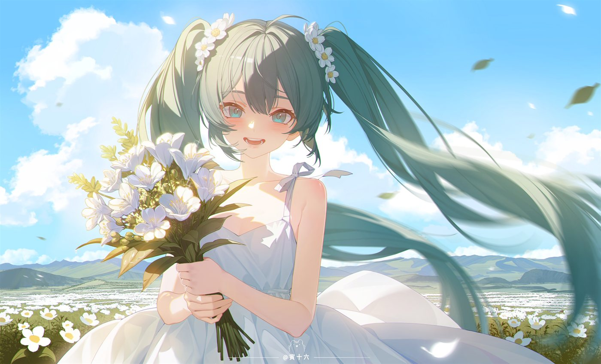

<h1 align="center">🎤 Hatsune Miku · 39</h1>

  

  
  
  

<i>「ミク、ここにいるよ」</i>

---

### 🎧 About me

- 🩵 код, чай и бирюзовый свет
- 🎶 Vocaloid, электроника, чиптюн
- 🖥️ тёмная тема + аниме-обои = дом

---

  
  

39 · made with 🩵 and teal pixels

